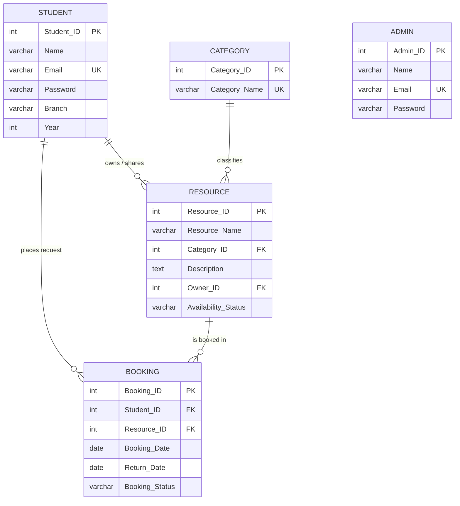

# CampusShare – Smart Campus Resource Sharing & Booking System
**A College DBMS Capstone Project**

---

## 1. Project Overview & Objective
**CampusShare** is a full-stack, beginner-friendly relational database management system designed for colleges. It provides a centralized, trustworthy platform where students and faculty can share and borrow campus resources such as laptops, DSLR cameras, lab equipment, reference textbooks, projectors, and study rooms.

### Key Objectives
- Prevent duplicate purchases and optimize resource utilization across academic departments.
- Replace manual register logbooks with an automated, auditable relational database.
- Demonstrate core DBMS principles: **Normalization (1NF, 2NF, 3NF)**, **Entity & Referential Integrity**, **Multi-table Relational JOINs**, **Aggregate Queries**, and **State Transition Workflows**.

---

## 2. Technology Stack (Beginner-Friendly & Zero-Dependency)
- **Frontend:** Pure HTML5, CSS3 (Modern Blue & White responsive theme), Vanilla JavaScript (Fetch API).
- **Backend Server:** Python standard library (`http.server`, `sqlite3`, `json`) — **No external packages required (no `pip install` issues)**.
- **Database Engine:** Standard SQL (SQLite / MySQL / phpMyAdmin compatible).

---

## 3. Project Structure
```text
dbms-capstone/
│
├── database/
│   ├── schema.sql              # Table creation DDL statements with constraints
│   ├── sample_data.sql         # Realistic college sample records
│   ├── queries.sql             # SQL queries demonstrating core DBMS concepts
│   ├── campus_share.sql        # Master all-in-one database script
│   └── campus_share.db         # Pre-populated SQLite database
│
├── templates/
│   ├── index.html              # Student & Admin authentication portal
│   ├── dashboard.html          # Student browsing, searching, and booking portal
│   └── admin.html              # Administrator management and approval control center
│
├── static/
│   ├── css/
│   │   └── style.css           # Modern blue & white college styling
│   └── js/
│       ├── auth.js             # Client-side validation and authentication
│       ├── dashboard.js        # Search, category filters, and request modals
│       └── admin.js            # Approval flows and inventory management
│
├── app.py                      # Lightweight Python web server and REST API
├── test_system.py              # Automated test suite
└── README.md                   # Full documentation & Viva Q&A
```

---

## 4. Database Design & Relational Schema

### 4.1 Relational Schema
Underlined attributes indicate **Primary Keys (PK)**; asterisks indicate **Foreign Keys (FK)**:
1. **Student** (<ins>Student_ID</ins>, Name, Email, Password, Branch, Year)
2. **Category** (<ins>Category_ID</ins>, Category_Name)
3. **Admin** (<ins>Admin_ID</ins>, Name, Email, Password)
4. **Resource** (<ins>Resource_ID</ins>, Resource_Name, Category_ID*, Description, Owner_ID*, Availability_Status)
   - `Category_ID` references `Category(Category_ID)`
   - `Owner_ID` references `Student(Student_ID)`
5. **Booking** (<ins>Booking_ID</ins>, Student_ID*, Resource_ID*, Booking_Date, Return_Date, Booking_Status)
   - `Student_ID` references `Student(Student_ID)`
   - `Resource_ID` references `Resource(Resource_ID)`

---

### 4.2 Entity-Relationship (ER) Diagram



---

### 4.3 Normalization Analysis (1NF to 3NF)

1. **First Normal Form (1NF):**
   - Every column holds atomic (single) values.
   - There are no repeating groups or composite columns (e.g., student branch and year are separate attributes).
2. **Second Normal Form (2NF):**
   - The relations are in 1NF.
   - All primary keys are single-column attributes (`Student_ID`, `Resource_ID`, `Booking_ID`). Therefore, **no partial dependency** can exist.
3. **Third Normal Form (3NF):**
   - The relations are in 2NF.
   - **No transitive dependency** ($X \rightarrow Y \rightarrow Z$).
   - For example: `Resource` stores only `Category_ID`. It does not store `Category_Name`. Storing `Category_Name` inside `Resource` would create a transitive dependency (`Resource_ID -> Category_ID -> Category_Name`), causing redundancy and update anomalies.

---

## 5. How to Run the Project

### Prerequisites
- Python 3.8 or higher installed on your computer.

### Step 1: Open Terminal / Command Prompt
Navigate to the project directory:
```bash
cd "c:\Users\PAYAL VERMA\OneDrive\Desktop\dbms- capstone"
```

### Step 2: Start the Web Server
Run the single command:
```bash
python app.py
```
*Note: On startup, the server automatically verifies `database/campus_share.db`. If the database is missing, it creates the tables and loads the realistic sample data automatically.*

### Step 3: Open in Browser
Open your browser and visit:
```text
http://localhost:8000
```

---

## 6. Pre-Configured Demo Accounts for Testing

| Role | Email | Password | Details |
| :--- | :--- | :--- | :--- |
| **Student** | `aarav.sharma@campus.edu` | `student123` | Aarav Sharma (Computer Science, Year 3) |
| **Student** | `priya.patel@campus.edu` | `student123` | Priya Patel (Electronics & Comm, Year 4) |
| **Admin** | `admin@campus.edu` | `admin123` | Prof. S. K. Gupta (System Administrator) |

*(Note: The login page has one-click chips that auto-fill these credentials for quick demonstrations).*

---

## 7. Testing Results & Verification

An automated test script is provided in `test_system.py`. To run the verification suite:
```bash
python test_system.py
```

### Test Suite Execution Output
```text
=== INITIALIZING DATABASE ===

=== 1. TEST CATEGORIES API ===
Passed: 6 categories retrieved.

=== 2. TEST RESOURCE SEARCH & FILTER API ===
Passed: Search for 'Camera' found 2 items.
Passed: Filter for Category 1 found 1 items.

=== 3. TEST AUTHENTICATION (Student & Admin) ===
Passed: Student login verified for Aarav Sharma.
Passed: Invalid student password correctly rejected with HTTP 401.
Passed: Admin login verified for Prof. S. K. Gupta.

=== 4. TEST ADDING NEW RESOURCE ===
Passed: Resource added with generated ID #9.

=== 5. TEST BOOKING CREATION, APPROVAL & AVAILABILITY TRANSITION ===
Passed: Booking #7 created in 'Pending' status.
Passed: Resource availability status automatically updated to 'Booked'.
Passed: Resource availability status automatically reverted to 'Available'.

=== 6. TEST ADMIN AGGREGATE STATS ===
Passed: Aggregations returned: 5 students, 9 resources.

------------------------------------------------------------
SUCCESS: ALL DBMS & BACKEND TESTS PASSED WITH 100% ACCURACY!
------------------------------------------------------------
```

---

## 8. Top 15 Viva Questions & Answers

### Q1: What is the main objective of your DBMS capstone project?
**Answer:** CampusShare is a centralized resource sharing and booking management system for universities. It enables students to share underutilized assets (laptops, cameras, reference textbooks, lab equipment) and allows administrators to oversee requests, manage inventory, and enforce accountability using relational integrity constraints.

### Q2: What is the difference between a Primary Key and a Foreign Key?
**Answer:**
- A **Primary Key** uniquely identifies each row in a table (e.g., `Student_ID` in `Student`) and cannot contain `NULL` values.
- A **Foreign Key** is an attribute in one table that references the Primary Key of another table (e.g., `Category_ID` in `Resource` references `Category(Category_ID)`), ensuring referential integrity.

### Q3: How did you ensure data integrity in your database?
**Answer:**
1. **Entity Integrity:** Implemented unique, non-null Primary Keys on all 5 tables.
2. **Referential Integrity:** Used Foreign Key constraints with `ON DELETE CASCADE` and `ON DELETE RESTRICT`.
3. **Domain Integrity:** Used `CHECK` constraints (e.g., `Year BETWEEN 1 AND 4`, `Return_Date >= Booking_Date`, status value enums) and `UNIQUE` constraints on emails and categories.

### Q4: Why is your database design in 3NF (Third Normal Form)?
**Answer:**
- **1NF:** All attributes are atomic with no repeating groups.
- **2NF:** All tables have single-column primary keys, eliminating any partial dependency.
- **3NF:** We removed transitive dependencies. For example, instead of storing `Category_Name` inside the `Resource` table, we extracted it into a separate `Category` table, eliminating redundancy and update anomalies.

### Q5: What happens when an Admin approves a booking request?
**Answer:** A synchronized transactional update takes place:
1. `Booking.Booking_Status` is updated from `'Pending'` to `'Approved'`.
2. The associated resource's `Availability_Status` in `Resource` is automatically set to `'Booked'`, ensuring no other student can request it simultaneously.

### Q6: What is the difference between `WHERE` and `HAVING` in SQL?
**Answer:**
- `WHERE` filters individual rows **before** any grouping or aggregation takes place.
- `HAVING` filters aggregated group records **after** the `GROUP BY` clause has been executed (e.g., `HAVING COUNT(Resource_ID) > 1`).

### Q7: What is an `INNER JOIN` and where did you use it?
**Answer:** An `INNER JOIN` returns rows that have matching values in both tables. We used a 3-table `INNER JOIN` between `Resource`, `Category`, and `Student` to display the full resource catalog with human-readable category names and owner details instead of foreign key integers.

### Q8: What is a `LEFT JOIN` and where is it useful in your project?
**Answer:** A `LEFT JOIN` returns all rows from the left table and matching rows from the right table, filling missing values with `NULL`. We used it when querying categories and counting resources so that categories with zero resources still appear in summary reports.

### Q9: What is `ON DELETE CASCADE` vs `ON DELETE RESTRICT`?
**Answer:**
- `ON DELETE CASCADE` (used between `Student` and `Resource`/`Booking`): If a student record is removed, all their listed resources and booking history are automatically deleted.
- `ON DELETE RESTRICT` (used between `Category` and `Resource`): Prevents an administrator from deleting a category if active resources are currently classified under it.

### Q10: How do you prevent SQL Injection attacks?
**Answer:** In `app.py`, all SQL queries use parameterized queries (e.g., `cursor.execute("SELECT * FROM Student WHERE Email = ?", (email,))`). The database driver treats parameters purely as literals, rendering malicious SQL injection strings harmless.

### Q11: What is a Subquery (Nested Query)?
**Answer:** A subquery is a query nested inside another SQL statement. For example, in `queries.sql`, we used `SELECT Resource_Name FROM Resource WHERE Resource_ID NOT IN (SELECT DISTINCT Resource_ID FROM Booking)` to find items that have never been requested.

### Q12: Why did you choose SQLite for development?
**Answer:** SQLite is serverless, zero-configuration, cross-platform, and stores the entire database in a single file (`campus_share.db`), while supporting standard SQL syntax (DDL, DML, foreign keys, transactions, and check constraints). The SQL script is also 100% compatible with MySQL / phpMyAdmin.

### Q13: Can a student book their own resource?
**Answer:** No. Our application logic in `app.py` enforces a validation check: `if res["Owner_ID"] == student_id`, the request is rejected with a message: *"You cannot book your own shared resource."*

### Q14: What is the role of the `CHECK` constraint in SQL?
**Answer:** `CHECK` limits the range of values that can be entered into a column. In CampusShare:
- `CHECK (Year BETWEEN 1 AND 4)` ensures academic years are realistic.
- `CHECK (Availability_Status IN ('Available', 'Booked', 'Maintenance'))` prevents typos or invalid states.
- `CHECK (Return_Date >= Booking_Date)` prevents logical date discrepancies.

### Q15: How are dates handled in your system?
**Answer:** The `Booking_Date` uses `DEFAULT (CURRENT_DATE)` so the database automatically records today's timestamp when a request is created. The HTML5 date picker enforces a minimum date of today for `Return_Date`.
