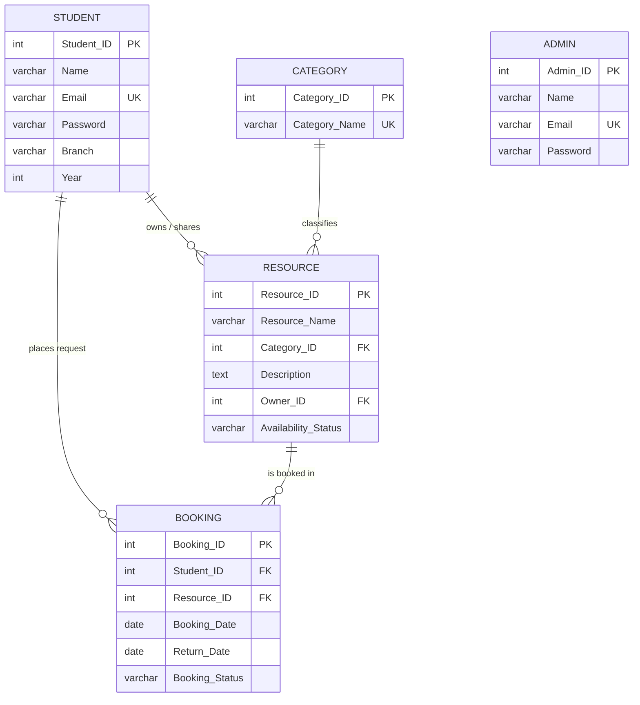

# CampusShare – Smart Campus Resource Sharing & Booking System
**A College DBMS Capstone Project**

---

## 1. Project Overview & Objective
**CampusShare** is a full-stack, beginner-friendly relational database management system designed for colleges. It provides a centralized, trustworthy platform where students and faculty can share and borrow campus resources such as laptops, DSLR cameras, lab equipment, reference textbooks, projectors, and study rooms.

### Key Objectives
- Prevent duplicate purchases and optimize resource utilization across academic departments.
- Replace manual register logbooks with an automated, auditable relational database.
- Demonstrate core DBMS principles: **Normalization (1NF, 2NF, 3NF)**, **Entity & Referential Integrity**, **Multi-table Relational JOINs**, **Aggregate Queries**, and **State Transition Workflows**.

---

## 2. Technology Stack (Beginner-Friendly & Zero-Dependency)
- **Frontend:** Pure HTML5, CSS3 (Modern Blue & White responsive theme), Vanilla JavaScript (Fetch API).
- **Backend Server:** Python standard library (`http.server`, `sqlite3`, `json`) — **No external packages required (no `pip install` issues)**.
- **Database Engine:** Standard SQL (SQLite / MySQL / phpMyAdmin compatible).

---

## 3. Project Structure
```text
dbms-capstone/
│
├── database/
│   ├── schema.sql              # Table creation DDL statements with constraints
│   ├── sample_data.sql         # Realistic college sample records
│   ├── queries.sql             # SQL queries demonstrating core DBMS concepts
│   ├── campus_share.sql        # Master all-in-one database script
│   └── campus_share.db         # Pre-populated SQLite database
│
├── templates/
│   ├── index.html              # Student & Admin authentication portal
│   ├── dashboard.html          # Student browsing, searching, and booking portal
│   └── admin.html              # Administrator management and approval control center
│
├── static/
│   ├── css/
│   │   └── style.css           # Modern blue & white college styling
│   └── js/
│       ├── auth.js             # Client-side validation and authentication
│       ├── dashboard.js        # Search, category filters, and request modals
│       └── admin.js            # Approval flows and inventory management
│
├── app.py                      # Lightweight Python web server and REST API
├── test_system.py              # Automated test suite
└── README.md                   # Full documentation & Viva Q&A
```

---

## 4. Database Design & Relational Schema

### 4.1 Relational Schema
Underlined attributes indicate **Primary Keys (PK)**; asterisks indicate **Foreign Keys (FK)**:
1. **Student** (<ins>Student_ID</ins>, Name, Email, Password, Branch, Year)
2. **Category** (<ins>Category_ID</ins>, Category_Name)
3. **Admin** (<ins>Admin_ID</ins>, Name, Email, Password)
4. **Resource** (<ins>Resource_ID</ins>, Resource_Name, Category_ID*, Description, Owner_ID*, Availability_Status)
   - `Category_ID` references `Category(Category_ID)`
   - `Owner_ID` references `Student(Student_ID)`
5. **Booking** (<ins>Booking_ID</ins>, Student_ID*, Resource_ID*, Booking_Date, Return_Date, Booking_Status)
   - `Student_ID` references `Student(Student_ID)`
   - `Resource_ID` references `Resource(Resource_ID)`

---

### 4.2 Entity-Relationship (ER) Diagram



---

### 4.3 Normalization Analysis (1NF to 3NF)

1. **First Normal Form (1NF):**
   - Every column holds atomic (single) values.
   - There are no repeating groups or composite columns (e.g., student branch and year are separate attributes).
2. **Second Normal Form (2NF):**
   - The relations are in 1NF.
   - All primary keys are single-column attributes (`Student_ID`, `Resource_ID`, `Booking_ID`). Therefore, **no partial dependency** can exist.
3. **Third Normal Form (3NF):**
   - The relations are in 2NF.
   - **No transitive dependency** ($X \rightarrow Y \rightarrow Z$).
   - For example: `Resource` stores only `Category_ID`. It does not store `Category_Name`. Storing `Category_Name` inside `Resource` would create a transitive dependency (`Resource_ID -> Category_ID -> Category_Name`), causing redundancy and update anomalies.

---

## 5. How to Run the Project

### Prerequisites
- Python 3.8 or higher installed on your computer.

### Step 1: Open Terminal / Command Prompt
Navigate to the project directory:
```bash
cd "c:\Users\PAYAL VERMA\OneDrive\Desktop\dbms- capstone"
```

### Step 2: Start the Web Server
Run the single command:
```bash
python app.py
```
*Note: On startup, the server automatically verifies `database/campus_share.db`. If the database is missing, it creates the tables and loads the realistic sample data automatically.*

### Step 3: Open in Browser
Open your browser and visit:
```text
http://localhost:8000
```

---

## 6. Pre-Configured Demo Accounts for Testing

| Role | Email | Password | Details |
| :--- | :--- | :--- | :--- |
| **Student** | `student@campusshare.com` | `student123` | Demo Student (Computer Science, Year 3) |
| **Faculty** | `faculty@campusshare.com` | `faculty123` | Demo Faculty (Computer Science, Associate Professor) |
| **Admin** | `admin@campusshare.com` | `admin123` | Demo Admin (System Administrator) |

*(Note: The login page has 1-Click Demo Login buttons that authenticate these credentials instantly).*

---

## 7. Testing Results & Verification

An automated test script is provided in `test_system.py`. To run the verification suite:
```bash
python test_system.py
```

### Test Suite Execution Output
```text
=== INITIALIZING CAMPUSSHARE DATABASE ===

=== 1. VERIFY DEMO LOGINS ===
Passed: Demo Student Login -> Demo Student (Role: student)
Passed: Demo Faculty Login -> Demo Faculty (Role: faculty, Dept: Computer Science)
Passed: Demo Admin Login -> Demo Admin (Role: admin)

=== 2. VERIFY CATEGORIES & RESOURCES ===
Passed: 6 categories available.
Passed: 11 resources retrieved with owner information.

=== 3. VERIFY FACULTY ASSET CREATION & BOOKING WORKFLOW ===
Passed: Faculty Asset registered with ID #12.
Passed: Booking Request #9 created in 'Pending' status.
Passed: Resource #12 availability status confirmed as 'Booked'.
Passed: Resource #12 availability successfully reverted to 'Available'.

=== 4. VERIFY ADMIN LIVE STATS ===
Passed: Admin Metrics -> Students: 6, Faculty: 3, Resources: 12, Active Loans: 3

------------------------------------------------------------
ALL TESTS PASSED! DEMO LOGIN & COMPLETE WORKFLOW FULLY VERIFIED.
------------------------------------------------------------
```
